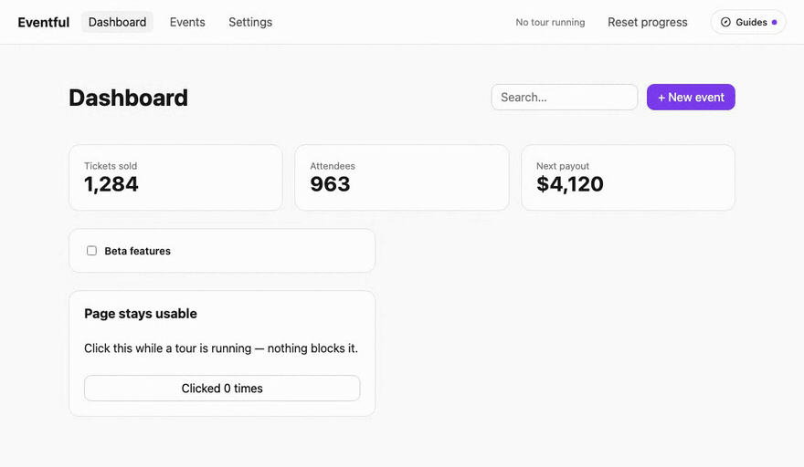
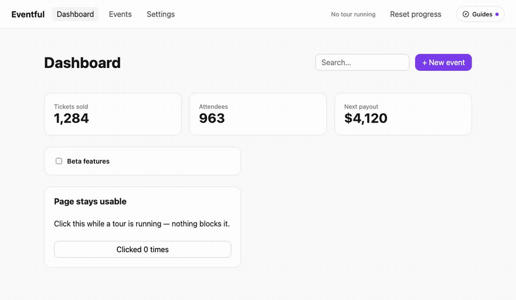
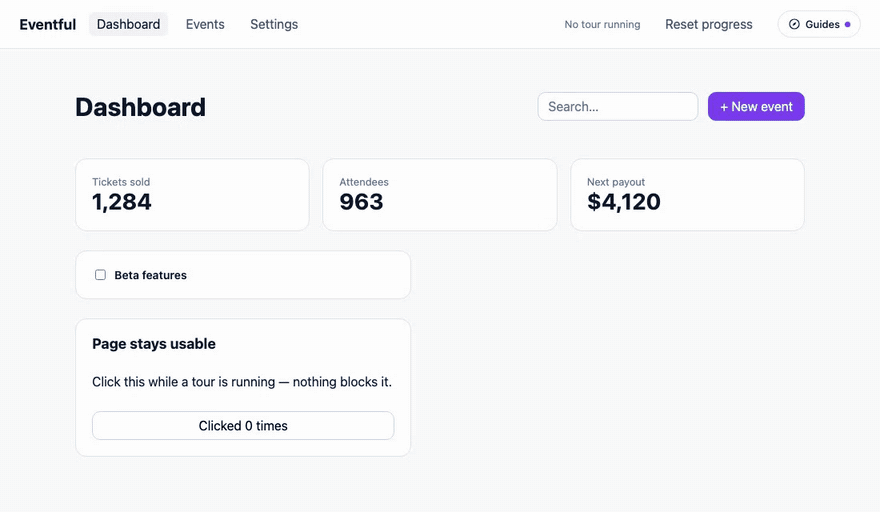
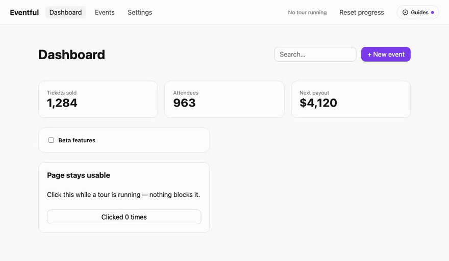

# guidecursor



**Product walkthroughs that show, not block.** A small animated cursor glides from one part of your UI to the next, the way a colleague would show you around. A popover explains each stop. There's no dimmed full-screen overlay, so the page stays usable the whole time, and users can skip or come back later.

- **Animated guide cursor.** It follows a curved, eased path between targets with requestAnimationFrame. It keeps tracking targets that scroll or reflow mid-flight, and it respects `prefers-reduced-motion`.
- **Non-blocking by default.** A soft highlight ring replaces the modal overlay. Clicks, typing and scrolling all keep working during a tour.
- **Skippable and resumable.** Esc or × skips a tour, and progress is saved. "Don't show again" turns off auto-start for every tour. Tours resume where the user left off, even after a full page reload.
- **Multi-page tours.** A step can declare a `route`. guidecursor calls your router's `navigate` and then waits for the target to appear.
- **Tours that fit the page.** A step's `when` check passes over steps that don't apply right now (an empty list, a feature that's off), so nothing times out and every tour fits the person taking it.
- **Opt-in auto-start.** Tours never pop up on their own unless you configure `autoStart`. The optional `<GuideMenu />` is a "Guides" dropdown that users open when they want help.
- **Accessible.** The popover is a non-modal `role="dialog"` with an `aria-live` announcement. Focus moves into it and is restored at the end. Keyboard: Esc, ←, →, Enter.
- **Pluggable persistence.** `localStorage` is the default, and every call is wrapped in try/catch. You can swap in your server with two functions.
- **Events for analytics.** `onStart`, `onStep`, `onSkip`, `onComplete`, `onDismiss`, `onEnd`, `onError`.
- **Small and framework-agnostic.** `@guidecursor/core` is about 9.7 kB min+gzip including its CSS. It's SSR-safe, ships ESM, CJS and types, and has no dependencies. `@guidecursor/react` adds about 2.1 kB.

MIT licensed.

**Docs:** [Getting started](docs/getting-started.md) · [How a tour runs](docs/concepts.md) · [Guides and recipes](docs/README.md) · [Examples](examples/README.md) · [Troubleshooting](docs/troubleshooting.md) · [Contributing](CONTRIBUTING.md)

---

## Install

```bash
npm install @guidecursor/core          # vanilla / any framework
npm install @guidecursor/react         # React 18 or 19 (includes core)
```

## Quick start: vanilla

```ts
import { createGuide } from "@guidecursor/core";

const guide = createGuide({
  tours: [
    {
      id: "basics",
      title: "The basics",
      steps: [
        { target: "#search", title: "Find anything", content: "Search events, vendors and payouts." },
        { target: () => document.querySelector("[data-tour=new]"), title: "Create", placement: "left" },
        { title: "That's it!", content: "A step without a target is centered." },
      ],
    },
  ],
  onStep: ({ tour, index }) => analytics.track("tour_step", { tour: tour.id, index }),
});

document.querySelector("#help")!.addEventListener("click", () => guide.start("basics"));
```

## Quick start: React

```tsx
import { GuideCursorProvider, GuideMenu, useGuideCursor, type GuideTour } from "@guidecursor/react";

const tours: GuideTour[] = [
  {
    id: "dashboard",
    title: "Dashboard tour",
    description: "Where everything lives",
    steps: [
      { route: "/", target: "#stats", title: "Your numbers" },
      { route: "/settings", target: "#payout-form", title: "Get paid" }, // navigates for you
    ],
  },
];

export function App() {
  const navigate = useNavigate(); // from your router
  return (
    <GuideCursorProvider tours={tours} navigate={(to) => navigate(to)}>
      <header>
        <GuideMenu />  {/* "Guides" dropdown; nothing auto-pops */}
      </header>
      <Routes />
    </GuideCursorProvider>
  );
}

function HelpButton() {
  const { start, isActive } = useGuideCursor();
  return <button onClick={() => start("dashboard")} disabled={isActive}>Show me around</button>;
}
```

`tours` should be referentially stable. Define it at module level or wrap it in `useMemo`.

---

## API reference

### `createGuide(options): Guide`

| Option | Type | Default | |
|---|---|---|---|
| `tours` | `GuideTour[]` | `[]` | Tour definitions (see below). |
| `storage` | `StorageAdapter` | `localStorageAdapter()` | Where progress is persisted. |
| `navigate` | `(route) => void \| Promise<void>` | `location.assign` | Your router's navigate. It's called for steps whose `route` doesn't match. |
| `getCurrentRoute` | `() => string` | `pathname + search` | The current route, used to decide whether to navigate. |
| `cursor` | `boolean \| { speed?, label?, ripple? }` | `true` | `label` shows a name tag next to the cursor. `speed` multiplies the glide duration. |
| `highlight` | `boolean` | `true` | Soft ring around the target. It never intercepts pointer events. |
| `placement` | `"auto" \| "top" \| "bottom" \| "left" \| "right"` | `"auto"` | Preferred popover side. It flips and shifts to stay in the viewport. |
| `offset` | `number` | `14` | Gap between the target and the popover, in px. |
| `targetTimeout` | `number` | `5000` | How long to wait for a step's target, in ms. |
| `onMissingTarget` | `"skip" \| "end" \| "center"` | `"skip"` | What to do when a target never appears. A step can override it. `"center"` shows the step anyway, so nothing silently disappears. |
| `motion` | `"auto" \| "reduce" \| "full"` | `"auto"` | `auto` follows `prefers-reduced-motion`. |
| `keyboard` | `boolean` | `true` | Esc skips. ←, → and Enter navigate (only when focus isn't in a page input). |
| `focus` | `boolean` | `true` | Move focus to the popover on each step. |
| `showProgress` / `showDontShowAgain` | `boolean` | `true` | Toggle the "1 of 5" label and the "Don't show again" link. |
| `labels` | `Partial<GuideLabels>` | English | `next`, `back`, `done`, `skip`, `dontShowAgain`, `progress(i, n)`. |
| `resumeOnLoad` | `boolean` | `true` | Resume a tour that was running when the page (re)loaded. |
| `autoStart` | `boolean` | `true` | Evaluate the tours' own `autoStart` settings on init. `false` disables auto-start globally. |
| `init` | `boolean` | `true` | Initialize right away in the browser. Adapters pass `false` and call `guide.init()`. |
| `injectStyles` / `styleNonce` | `boolean` / `string` | `true` | Set `false` and import `@guidecursor/core/styles.css` for strict CSP. |
| `container` | `() => HTMLElement` | `document.body` | Where the UI is mounted. |
| `className` | `string` | | Extra class on the overlay root. |
| `onStart`, `onStep`, `onSkip`, `onComplete`, `onDismiss`, `onEnd`, `onError` | callbacks | | See [Events](#events). |

#### `GuideTour`

```ts
{
  id: string;
  title: string;                // shown in <GuideMenu />
  description?: string;
  steps: GuideStep[];
  autoStart?: boolean | ((ctx: { tour, status, route, guide }) => boolean | Promise<boolean>);
  autoStartDelay?: number;      // ms, default 600
  hidden?: boolean;             // hide from <GuideMenu />
}
```

`autoStart` only ever fires for a tour the user has never seen (status `"new"`). It doesn't fire if the user chose "Don't show again", or while another tour is running.

#### `GuideStep`

```ts
{
  id?: string;
  target?: string | Element | (() => Element | null);  // omit for a centered step
  title?: string;
  content?: string | Node | ((ctx) => string | Node);   // strings are rendered as text, never HTML
  placement?: "auto" | "top" | "bottom" | "left" | "right";
  align?: "start" | "center" | "end";
  route?: string;                                      // e.g. "/settings" or "/account?tab=payout"
  routeMatch?: string | RegExp | ((current) => boolean); // for dynamic segments
  highlight?: boolean;
  cursor?: boolean;
  advanceOn?: "click" | { event: string; selector?: string }; // advance on a real user action
  timeout?: number;                                    // per-step targetTimeout
  onMissingTarget?: "skip" | "end" | "center";         // per-step override
  when?: (ctx) => boolean | Promise<boolean>;          // show only when it applies (see below)
  hideBack?: boolean;
  focus?: boolean;
  beforeShow?: (ctx) => void | Promise<void>;          // open a menu, switch a tab, fetch…
  onShow?: (ctx) => void;
  onHide?: (ctx) => void;
  data?: Record<string, unknown>;
}
```

`when` runs after `route` navigation and `beforeShow`, so it can look at the page. Returning `false` passes over the step in the direction the user is moving (Next skips forward, Back skips back) and is **not** reported as an error. Use it for steps that only apply sometimes, like a tab only some records have. A missing target, on the other hand, usually means the tour and the page have drifted apart, so it's reported as `target-missing`. See [Interactive and conditional steps](docs/guides/interactive-steps.md).



A string `route` matches when the path is equal, ignoring trailing slashes and the hash. Any query params in the step's route must also be present: `/account?tab=payout` matches `/account?tab=payout&x=1` but not `/account`.

#### `Guide` instance

| Method | |
|---|---|
| `start(tourId, { step?, resume? })` | Start a tour, optionally at a step index or id. With `resume: true` it continues from the saved step. Returns `Promise<boolean>`. |
| `resume(tourId?)` | Continue a tour at its saved step (defaults to the last active tour). |
| `next()` / `back()` / `goTo(indexOrId)` | Navigate. Calling `next()` on the last step completes the tour. |
| `skip()` | End early. The status becomes `"skipped"`, the step is remembered, and `onSkip` fires. |
| `dismiss()` | "Don't show again". The status becomes `"dismissed"` and auto-start is muted for every tour. |
| `stop()` | End quietly. The status stays `"in-progress"`. |
| `complete()` | Mark the running tour completed. |
| `reset(tourId?)` | Forget progress for one tour, or for everything. |
| `getState()` / `subscribe(fn)` | Immutable state snapshots: `{ phase, tourId, stepIndex, stepCount, progress, muted, ready }`. Compatible with `useSyncExternalStore`. |
| `on(event, fn)` | Subscribe to an event. Returns an unsubscribe function. |
| `getTourStatus(id)` | `"new" \| "in-progress" \| "skipped" \| "completed" \| "dismissed"` |
| `setTours(tours)` / `getTours()` | Replace or read the tour list. |
| `checkAutoStart()` | Re-evaluate `autoStart` conditions, for example after a route change. |
| `refresh()` | Recompute positions after layout changes the guide couldn't observe. |
| `init()` | Load progress, resume, and auto-start. Idempotent. |
| `destroy()` | Remove the UI and listeners. The instance can be reused (it remounts lazily). |

`phase` moves through `idle → navigating → waiting → moving → showing`.

#### Events

| Event | Payload | When |
|---|---|---|
| `start` | `{ tour }` | A tour starts or resumes. |
| `step` | `{ tour, step, index, total, target }` | A step is visible, after the cursor arrives. |
| `skip` | `{ tour, step, index }` | Esc, ×, or `skip()`. |
| `dismiss` | `{ tour, step, index }` | "Don't show again". |
| `complete` | `{ tour }` | The last step is finished. |
| `end` | `{ tour, reason, index }` | Any ending. `reason` is one of `completed`, `skipped`, `dismissed`, `stopped`, `interrupted` or `error`. |
| `error` | `{ type, error?, tour?, step?, index? }` | `target-missing`, `storage`, `navigation`, or `callback`. The tour keeps going. |

A callback that throws never breaks the tour. The error is reported through `error`.

### Persistence

```ts
interface StorageAdapter {
  load(): PersistedData | null | Promise<PersistedData | null>;
  save(data: PersistedData): void | Promise<void>;
}
```

`PersistedData` is a small JSON object: `{ v: 1, tours: { [id]: { status, step, updatedAt } }, active, muted }`.

Built-in adapters:

- `localStorageAdapter({ key?, session? })`. Corrupt JSON, private mode, quota errors and disabled storage all degrade to "no saved progress". Use a per-user `key` on shared machines.
- `memoryStorage()`. Persists nothing, which is handy for tests.

If you write a server-side adapter, failures are caught and reported as `error` events of type `storage`, and the tour keeps working in memory:

```ts
const serverStorage: StorageAdapter = {
  load: () => fetch("/api/me/tours").then((r) => (r.ok ? r.json() : null)),
  save: (data) => fetch("/api/me/tours", { method: "PUT", body: JSON.stringify(data) }).then(() => {}),
};
```

### Multi-page tours

When a step's `route` doesn't match the current route, guidecursor does three things:

1. It saves progress, including the active step. If `navigate` triggers a full page load, `resumeOnLoad` picks the tour back up after the reload.
2. It calls `navigate(route)` and awaits it if it returns a promise.
3. It waits up to `targetTimeout` for the target, using a MutationObserver plus a slow poll for CSS-only visibility changes.

If the user wanders off mid-step and the target disappears, the guide hides the popover and waits for the target to come back. If it doesn't, the tour ends as `interrupted` and can still be resumed.

### Theming

Everything is driven by CSS custom properties. Set them on `:root` or on any ancestor:

```css
:root {
  --gc-accent: #7c3aed;        /* cursor, ring, primary button */
  --gc-accent-fg: #fff;
  --gc-bg: #fff;
  --gc-fg: #18181b;
  --gc-muted: #71717a;
  --gc-border: rgba(24, 24, 27, .1);
  --gc-radius: 14px;
  --gc-font: inherit;
  --gc-shadow: 0 12px 32px -8px rgba(0, 0, 0, .25);
  --gc-ring: var(--gc-accent);
  --gc-cursor-fill: var(--gc-accent);
  --gc-cursor-stroke: #fff;
  --gc-popover-width: 320px;
  --gc-z: 2147483000;
}
@media (prefers-color-scheme: dark) {
  :root { --gc-bg: #18181b; --gc-fg: #fafafa; --gc-muted: #a1a1aa; --gc-border: rgba(255, 255, 255, .12); }
}
```

You can also style the classes directly: `.gc-cursor`, `.gc-popover`, `.gc-ring`, `.gc-btn`, `.gc-menu-*`.



---

## React

### `<GuideCursorProvider>`

It accepts every `createGuide` option, plus:

- `tours` (required)
- `currentRoute?: string`. Pass your router's current location. When it changes, `autoStart` conditions are re-checked. It's also the default `getCurrentRoute`.
- `guide?: Guide`. Bring your own instance.

Callbacks such as `navigate` and `onStep` can change between renders, and the latest ones are always used. The provider is safe under StrictMode (a double mount resumes cleanly) and under SSR (nothing touches `window` during render).

### `useGuideCursor()`

This hook returns the reactive state plus bound controls:

```ts
const {
  phase, tourId, stepIndex, stepCount, progress, muted, ready,
  isActive, currentTour, currentStep,
  tours,   // [{ id, title, description, hidden, status, step, stepCount }]
  start, resume, next, back, goTo, skip, dismiss, stop, reset,
  guide,   // the underlying Guide
} = useGuideCursor();
```

`useGuide()` returns just the `Guide` instance.

### `<GuideMenu />`

A custom "Guides" dropdown that never interrupts. It lists tours with their status (New, 2/5, Done) and starts or resumes the one the user picks. It works with the keyboard (↑ ↓ Home End Esc), closes on an outside click, and uses `aria-haspopup="menu"`.

| Prop | Default | |
|---|---|---|
| `label` | `"Guides"` | Trigger content. |
| `heading` | `"Guides"` | Panel heading. `null` hides it. |
| `tours` | all | Only list these ids, in this order. Hidden tours are always excluded. |
| `align` | `"end"` | Which edge of the trigger the panel aligns to. |
| `showNewIndicator` | `true` | Shows a dot while some tours are still new. |
| `statusText` | built-in | `(tour) => string` |
| `resume` | `true` | Where a half-finished tour picks up. `true`: continue tours that are in progress or were skipped. `"in-progress"`: continue only tours cut off by a reload or navigation, and start skipped ones over. `false`: always start from the first step. Or a function `(tour) => boolean`. |
| `emptyText`, `className`, `onSelect` | | |



---

## Using with TanStack Router

Mount the provider inside the router, for example in `__root.tsx`, so it can use router hooks. Use `navigate({ href })`, which accepts a full path including `?search`:

```tsx
// src/routes/__root.tsx
import { Outlet, createRootRouteWithContext, useRouter, useRouterState } from "@tanstack/react-router";
import { GuideCursorProvider } from "@guidecursor/react";
import { tours } from "../tours";

function Root() {
  const router = useRouter();
  const href = useRouterState({ select: (s) => s.location.href }); // pathname + search
  return (
    <GuideCursorProvider
      tours={tours}
      currentRoute={href}
      navigate={(to) => router.navigate({ href: to })}
      onStep={({ tour, index }) => track("tour_step", { tour: tour.id, index })}
    >
      <Outlet />
    </GuideCursorProvider>
  );
}

export const Route = createRootRouteWithContext<MyRouterContext>()({ component: Root });
```

`router.navigate` returns a promise that resolves once navigation (including loaders) is done. guidecursor awaits it, then waits for the step's target. Route guards are fine: if a guard redirects, the target never appears, and the step is skipped after `targetTimeout`.

If the provider has to sit outside `<RouterProvider>`, use the router instance directly:

```tsx
<GuideCursorProvider
  tours={tours}
  navigate={(to) => router.navigate({ href: to })}
  getCurrentRoute={() => router.state.location.href}
/>
```

For dynamic segments, give the step a real URL to navigate to, plus a matcher:

```ts
{ route: `/organizer/events/${id}`, routeMatch: /^\/organizer\/events\/[^/]+$/, target: "[data-tour=ticket-tiers]" }
```

---

## Accessibility

- The popover is `role="dialog"` with `aria-modal="false"`, and it's labelled by its title and described by its body. It's non-modal on purpose: the page stays operable and focus isn't trapped.
- Each step is also announced through a polite `aria-live` region, including "2 of 5", the title and the text.
- Focus moves into the popover on each step, which you can turn off globally or per step. When the tour ends, focus returns to the element that had it before.
- Keyboard: Esc skips. ← and → navigate, and Enter advances when the popover is focused. Keys typed into page inputs are ignored, as is an Esc that the page already handled (`event.defaultPrevented`).
- The cursor, ring and ripple are `aria-hidden` and `pointer-events: none`.
- With `prefers-reduced-motion: reduce` (or `motion: "reduce"`), the cursor jumps instead of gliding and all transitions and ripples are disabled.
- String content is rendered with `textContent`, never `innerHTML`.
- `<GuideMenu />` follows the menu-button pattern: `aria-haspopup`, `aria-expanded`, `role="menu"`/`menuitem`, and roving focus.

Known gaps: there are no RTL-specific placement tweaks yet, and screen readers may hear a step twice (once from the live region and once when the dialog is focused). Set `focus: false` if you prefer only the live region.

## How it compares

| | **guidecursor** | driver.js | Shepherd.js | React Joyride | Intro.js |
|---|---|---|---|---|---|
| License | **MIT** | MIT | AGPL-3.0 or commercial (v14+) | MIT | AGPL-3.0 or commercial |
| Approach | Animated cursor + popover + soft ring | Overlay with cut-out highlight | Popovers + optional modal overlay | Beacons/tooltips + overlay | Overlay + tooltips |
| Page usable during tour | Yes, by default | Overlay blocks by default | Yes without the modal overlay | Overlay blocks by default (configurable) | Overlay blocks |
| Framework | Vanilla + React adapter | Vanilla | Vanilla (+ wrappers) | React only | Vanilla (+ wrappers) |
| Multi-page tours with router hook | Built in (`route` + `navigate`, waits for target) | Manual | Manual | Manual (controlled mode) | Manual |
| Persistence / resume | Built in, pluggable (server-ready) | Manual | Manual | Manual | "Don't show again" cookie |
| On-demand tour menu | `<GuideMenu />` | No | No | No | No |

The API intentionally feels familiar. Steps have a `target` (driver.js: `element`; Shepherd: `attachTo.element`), and the instance has `start`/`next`/`back`, similar to driver.js `drive()`/`moveNext()` and Shepherd `tour.start()`/`next()`/`back()`. Comparisons reflect each project's docs at the time of writing, so check them for current details.

## Development

See [CONTRIBUTING.md](CONTRIBUTING.md) for the architecture, the test setup, a worked example of adding a feature, and the release steps. In short: `npm install`, `npm run build`, `npm test`, `npm run test:e2e`, `npm run lint`, `npm run typecheck`. The demo runs with `npm run dev -w @guidecursor/demo`, and `npm run record:gifs` re-records the GIFs in these docs.

## License

[MIT](LICENSE)
