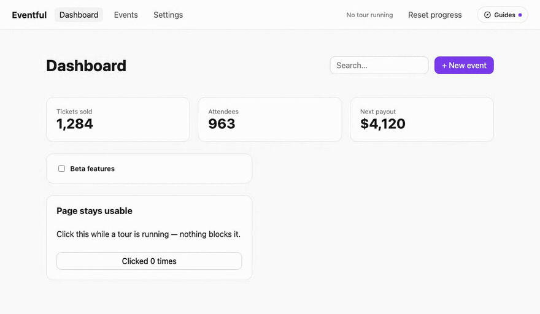

# guidecursor docs

Start with **[Getting started](getting-started.md)**: install guidecursor and ship your first tour in about five minutes. Then read **[How a tour runs](concepts.md)**, which explains the step lifecycle that every other page builds on.

## Guides

| Guide | Read it when you want to… |
|---|---|
| [Multi-page tours](guides/multi-page-tours.md) | Walk people across pages with React Router, TanStack Router, Next.js or plain links |
| [Interactive and conditional steps](guides/interactive-steps.md) | Wait for a real click, open menus and tabs for the user, or show a step only when it applies (`when`) |
| [Contextual help buttons](guides/contextual-help.md) | Put a "How does this work?" button next to a complex feature that starts the tour at the right step |
| [Saving progress](guides/persistence.md) | Store progress per user, on your server, or not at all |
| [Theming and labels](guides/theming-and-labels.md) | Match your brand, support dark mode, translate the buttons |
| [Analytics](guides/analytics.md) | Track starts, completions and drop-off per step |
| [Testing your tours](guides/testing-tours.md) | Catch tours that drift away from the UI before your users do |
| [Troubleshooting](troubleshooting.md) | A step was skipped, the popover is behind a modal, the cursor never moves… |

## Reference

- [API reference](../README.md#api-reference) for `createGuide`, `GuideTour`, `GuideStep`, the `Guide` instance and events
- [React bindings](../README.md#react) for `<GuideCursorProvider>`, `useGuideCursor()` and `<GuideMenu />`
- [Examples](../examples/README.md): copy-paste sample code
- [Changelog](../CHANGELOG.md)

## Contributing

Found a gap in these docs? See [CONTRIBUTING.md](../CONTRIBUTING.md#docs-and-gifs). Every page here is plain Markdown, and the GIFs are recorded from the demo app with `npm run record:gifs`.
