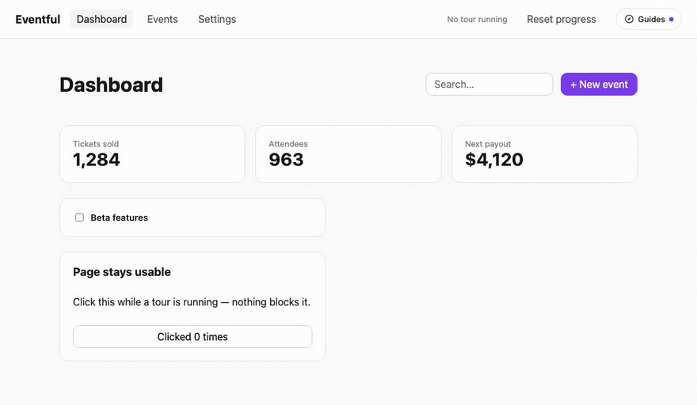
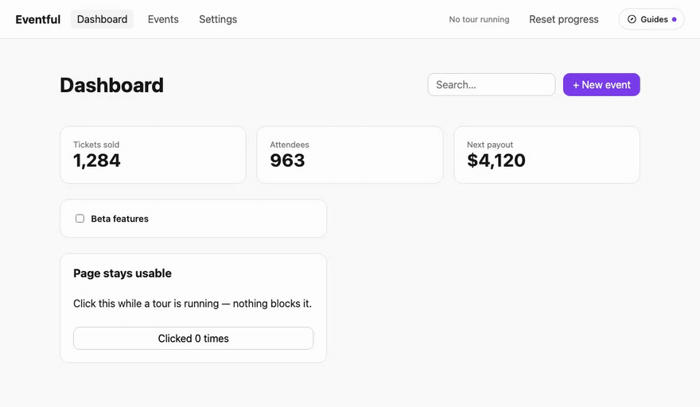

# Interactive and conditional steps

Tours feel natural when they follow what people actually do. This page covers four tools:

- **`advanceOn`** waits for a real action, like a click, before moving on
- **`beforeShow`** prepares the page: opens a menu, switches a tab, clicks through to a record
- **`when`** shows a step only when it applies
- **`target` functions** pick the best element at the moment the step shows

## Wait for a real click: `advanceOn`



```ts
{ target: "#counter", title: "Try it", content: "Click the button. The tour moves on when you do.", advanceOn: "click", focus: false }
```

- `advanceOn: "click"` moves on when the target (or anything inside it) is clicked.
- `advanceOn: { event: "submit", selector: "form#signup" }` moves on when that event fires on an element matching the selector. Any DOM event works, including your own `CustomEvent`s:

```ts
// The step moves on only once the app says the draft was saved:
{ target: "[data-tour=save]", title: "Save and continue", advanceOn: { event: "app:draft-saved", selector: "#event-form" } }

// …and in the app, after a successful save, once the next screen has rendered:
formRoot.dispatchEvent(new CustomEvent("app:draft-saved", { bubbles: true }));
```

This beats advancing on the button click itself: if validation fails, the tour stays put instead of racing ahead.

- Set `focus: false` on steps where people need to click or type in the page, so focus doesn't jump into the popover.
- The Next button still works. If Next should also do the action, add a `beforeShow` to the **following** step (see below).

## Prepare the page: `beforeShow`

`beforeShow(ctx)` runs after navigation and before guidecursor looks for the target. It can be async. Use it to open things:

```ts
{
  target: "[data-tour=export-menu]",
  title: "Export",
  beforeShow: async () => {
    document.querySelector<HTMLButtonElement>("[data-tour=more-actions]")?.click();
  },
}
```

### Click-through to a record

A common pattern: one step asks people to open an item from a list (`advanceOn: "click"`), and the next step explains the detail page. If they press **Next** instead of clicking, open the first item for them:

```ts
const onBookingPage = () => /^\/bookings\/[^/]+$/.test(location.pathname);

/** If we're not there yet, click the first item and wait until we arrive. */
function openFirst(selector: string, arrived: () => boolean) {
  return async () => {
    if (arrived()) return;
    const el = document.querySelector<HTMLElement>(selector);
    (el?.matches("a, button") ? el : el?.querySelector<HTMLElement>("a[href], button") ?? el)?.click();
    for (let i = 0; i < 100 && !arrived(); i++) await new Promise((r) => setTimeout(r, 60));
  };
}

const steps: GuideStep[] = [
  { route: "/bookings", target: "[data-tour=booking-row]", title: "Open a booking", advanceOn: "click" },
  {
    beforeShow: openFirst("[data-tour=booking-row]", onBookingPage),
    when: onBookingPage, // no bookings? pass over the detail steps instead of failing
    target: "[data-tour=payment-steps]",
    title: "Payment steps",
  },
];
```

## Show a step only when it applies: `when`



`when(ctx)` runs after `route` and `beforeShow`. Return `false` and the step is passed over in the direction the person is moving: Next skips forward and Back skips back. It isn't reported as an error. Use it for anything that legitimately applies only sometimes:

```ts
{ target: "[data-tour=guest-list]", title: "Guest list", when: () => !!document.querySelector("[data-tour=guest-list]") }  // only private events have one
{ target: "[data-tour=wallet]", title: "Your wallet", when: () => user.country === "NG" }                                 // feature by region
{ target: "[data-tour=lineup-add]", title: "Add someone", when: () => form.dataset.step === "1" }                       // only once the form is on that part
```

The step counter still shows the step's real position (for example "3 of 8"), so people can tell they're near the end.

### Wait for data before you decide

`when` runs as soon as the page is ready to look at, which may be before your data has loaded. If "no rows yet" can mean "still loading", wait for the list to settle first:

```ts
const BUSY = '[aria-busy="true"], [role="status"]';
const settled = (sel: string) => {
  const el = document.querySelector(sel);
  return !!el && !el.matches(BUSY) && !el.querySelector(BUSY);
};
const until = async (check: () => boolean, ms = 8000) => {
  for (const end = Date.now() + ms; Date.now() < end; await new Promise((r) => setTimeout(r, 60))) if (check()) return true;
  return check();
};

{
  target: "[data-tour=booking-row]",
  title: "Open a booking",
  when: async () => {
    await until(() => settled("[data-tour=bookings-list]"));
    return !!document.querySelector("[data-tour=booking-row]");
  },
}
```

Mark your loading states with `aria-busy="true"` or `role="status"` (good for screen readers anyway) and this pattern works everywhere.

### `when` or a missing target?

If you find yourself raising `targetTimeout` just so a step fails quietly, use `when` instead. Missing targets are reported because they usually mean the tour and the UI have drifted apart. See [How a tour runs](../concepts.md#passed-over-vs-missing).

## Pick the target at show time

`target` can be a function that returns an element or `null`. guidecursor keeps calling it until it returns a visible element or times out. That's handy for fallbacks:

```ts
// The real panel once it's open, otherwise its tab in the step indicator
target: () => (form.dataset.step === "2" ? document.querySelector("[data-tour=tickets-panel]") : document.querySelector("[data-tour=step-tickets]"))
```

`content` can also be a function, so the copy can match the situation:

```ts
content: () => (document.querySelector("[data-tour=booking-row]") ? "Click a booking to open it." : "Your bookings will appear here.")
```
