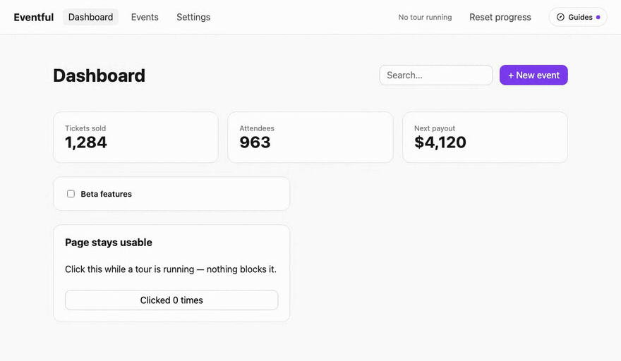

# Multi-page tours

A step can live on another page. Give it a `route`: when the current route doesn't match, guidecursor saves progress, calls your router's `navigate(route)`, and waits for the target to appear on the new page.



```ts
const tour: GuideTour = {
  id: "get-paid",
  title: "Get paid",
  steps: [
    { route: "/", target: "[data-tour=stats]", title: "Your sales" },
    { route: "/settings", target: "[data-tour=payout-form]", title: "Add a payout account" },
    { route: "/settings?tab=history", target: "[data-tour=payouts]", title: "Payout history" },
  ],
};
```

## How routes match

- A string `route` matches when the **path** is the same, ignoring trailing slashes and the hash.
- Query params in the step's route must be present with the same value: `/settings?tab=history` matches `/settings?tab=history&x=1` but not `/settings`.
- For dynamic segments, use `routeMatch` with a regular expression or a function. Pass the full URL (path plus search) through `getCurrentRoute` if your matchers look at the query string.

```ts
{ route: `/events/${id}`, routeMatch: /^\/events\/[^/]+$/, target: "[data-tour=tickets]" }
```

When you can't know the URL ahead of time (for example "the first booking in the list"), leave `route` off. Instead, open the record in `beforeShow` and check you arrived with `when`. See [Interactive and conditional steps](interactive-steps.md#click-through-to-a-record).

## Connect your router

guidecursor needs two things from your router: a way to **navigate**, and the **current route**. If you don't pass them, it uses `location.assign` (a full page load) and `location.pathname + location.search`. That works, but it's slower.

### React Router (v6.4+ / v7)

```tsx
import { GuideCursorProvider } from "@guidecursor/react";
import { Outlet, useLocation, useNavigate } from "react-router-dom";
import { tours } from "./tours";

export function RootLayout() {
  const navigate = useNavigate();
  const location = useLocation();
  return (
    <GuideCursorProvider
      tours={tours}
      navigate={(to) => navigate(to)}
      currentRoute={location.pathname + location.search}
    >
      <Outlet />
    </GuideCursorProvider>
  );
}
```

### TanStack Router

Put the provider inside the router (for example in `__root.tsx`). `router.navigate({ href })` accepts a full path including `?search`, and returns a promise that resolves once loaders are done. guidecursor awaits it.

```tsx
import { GuideCursorProvider } from "@guidecursor/react";
import { Outlet, useRouter, useRouterState } from "@tanstack/react-router";

function Root() {
  const router = useRouter();
  const href = useRouterState({ select: (s) => s.location.href });
  return (
    <GuideCursorProvider tours={tours} currentRoute={href} navigate={(to) => router.navigate({ href: to })}>
      <Outlet />
    </GuideCursorProvider>
  );
}
```

### Next.js (App Router)

The provider uses browser APIs, so mount it in a client component:

```tsx
// app/guides-provider.tsx
"use client";
import { GuideCursorProvider } from "@guidecursor/react";
import { usePathname, useRouter, useSearchParams } from "next/navigation";
import { tours } from "./tours";

export function GuidesProvider({ children }: { children: React.ReactNode }) {
  const router = useRouter();
  const pathname = usePathname();
  const search = useSearchParams().toString();
  return (
    <GuideCursorProvider
      tours={tours}
      navigate={(to) => router.push(to)}
      currentRoute={search ? `${pathname}?${search}` : pathname}
    >
      {children}
    </GuideCursorProvider>
  );
}
```

`router.push` doesn't return a promise. That's fine: guidecursor waits for the next step's target to appear on the new page (up to `targetTimeout`).

### Vanilla, or any other router

```ts
const guide = createGuide({
  tours,
  navigate: (to) => myRouter.go(to),          // may return a promise
  getCurrentRoute: () => myRouter.currentUrl,  // path + search
});
```

## Slow pages and route guards

- Raise `targetTimeout` (default 5000 ms), or a step's `timeout`, for pages whose data loads slowly.
- If a guard redirects (for example to sign-in), the target never appears and the step is handled by `onMissingTarget`. Hide tours people can't use with `hidden: true`, rather than letting them fail.

## Resuming after a full reload

Progress is saved before every navigation, so a full page load (or the person pressing refresh) resumes the tour at the same step. Turn that off with `resumeOnLoad: false`.
