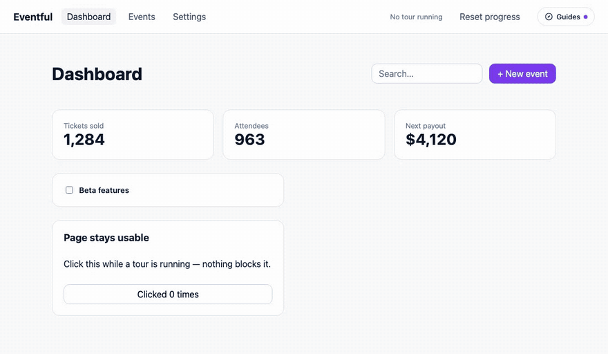

# Theming and labels



## Colours, radius and fonts

Everything is driven by CSS custom properties with sensible fallbacks. Set them on `:root`, or on any ancestor of the guide's container:

```css
:root {
  --gc-accent: #7417c6;      /* cursor, ring, primary button */
  --gc-accent-fg: #fff;
  --gc-bg: #fff;
  --gc-fg: #18181b;
  --gc-muted: #71717a;
  --gc-border: rgba(24, 24, 27, 0.1);
  --gc-radius: 14px;
  --gc-font: inherit;        /* use your app's font */
  --gc-popover-width: 320px;
  --gc-z: 2147483000;        /* lower it if your own modals must sit on top */
}

@media (prefers-color-scheme: dark) {
  :root {
    --gc-bg: #18181b;
    --gc-fg: #fafafa;
    --gc-muted: #a1a1aa;
    --gc-border: rgba(255, 255, 255, 0.12);
  }
}
```

The full list is in the [README](../../README.md#theming). You can also style the classes directly: `.gc-popover`, `.gc-title`, `.gc-btn`, `.gc-next`, `.gc-ring`, `.gc-cursor`, `.gc-menu-*`. Pass `className` to add your own class to the overlay root.

## The cursor

```ts
createGuide({ cursor: { label: "Eve", speed: 0.8, ripple: true } });
```

- `label` shows a name tag next to the cursor, like a multiplayer cursor. Your product's name works well.
- `speed` scales the glide duration: `0.5` is twice as fast.
- `cursor: false` turns it off, and a step can hide it with `cursor: false`.
- With `prefers-reduced-motion`, the cursor jumps instead of gliding. Force a mode with `motion: "reduce" | "full"`.

## Strict CSP

Styles are injected as a `<style>` tag by default. Pass `styleNonce` for a nonce-based CSP, or set `injectStyles: false` and import the stylesheet yourself:

```ts
import "@guidecursor/core/styles.css";
createGuide({ tours, injectStyles: false });
```

## Labels and translation

```ts
createGuide({
  labels: {
    next: "Suivant",
    back: "Retour",
    done: "Terminé",
    skip: "Passer la visite",
    dontShowAgain: "Ne plus afficher",
    progress: (current, total) => `${current} sur ${total}`,
  },
});
```

`<GuideMenu />` takes `label`, `heading`, `emptyText` and `statusText` for its own text:

```tsx
<GuideMenu
  label="Guides"
  statusText={(t) => (t.status === "completed" ? "Done" : t.status === "new" ? "New" : `${t.step + 1}/${t.stepCount}`)}
/>
```
