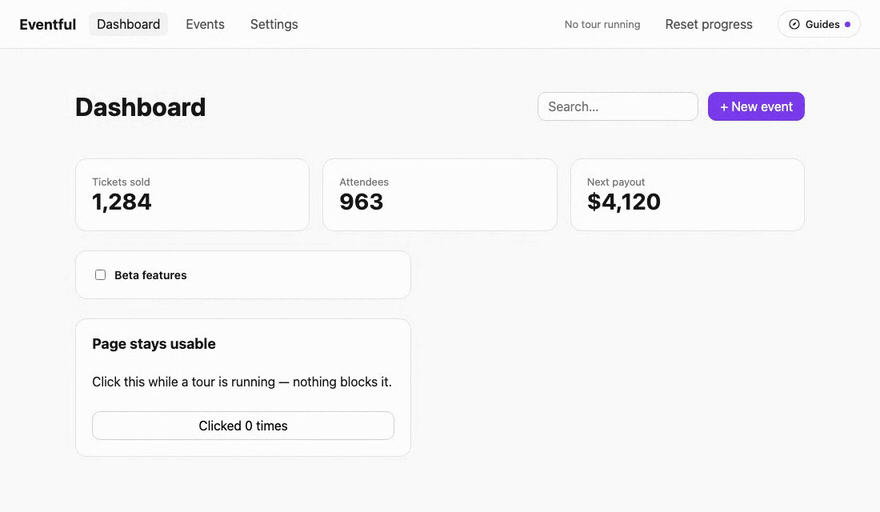

# @guidecursor/core

**Guide your users through your product, right inside your app.** An animated cursor glides from one part of your UI to the next and a popover explains each stop. There's no dimmed overlay, so the page stays usable. Framework-agnostic, about 10 kB min+gzip with CSS, zero dependencies.



```bash
npm install @guidecursor/core
```

```ts
import { createGuide } from "@guidecursor/core";

const guide = createGuide({
  tours: [
    {
      id: "basics",
      title: "The basics",
      steps: [
        { target: "#search", title: "Find anything", content: "Search events, people and payouts." },
        { target: "[data-tour=new]", title: "Create", content: "Start something new here.", placement: "left" },
        { title: "That's it!", content: "A step without a target is centered." },
      ],
    },
  ],
});

document.querySelector("#help")?.addEventListener("click", () => guide.start("basics"));
```

Using React? Install [`@guidecursor/react`](https://www.npmjs.com/package/@guidecursor/react) instead. It includes this package.

## Learn more

- [Getting started](https://github.com/Eve-Eng01/guidecursor/blob/main/docs/getting-started.md)
- [How a tour runs](https://github.com/Eve-Eng01/guidecursor/blob/main/docs/concepts.md)
- [Guides and recipes](https://github.com/Eve-Eng01/guidecursor/blob/main/docs/README.md): multi-page tours, conditional steps, help buttons, saving progress, theming, analytics, testing
- [API reference](https://github.com/Eve-Eng01/guidecursor#api-reference)
- [Examples](https://github.com/Eve-Eng01/guidecursor/tree/main/examples)

MIT licensed. Issues and contributions welcome on [GitHub](https://github.com/Eve-Eng01/guidecursor).
