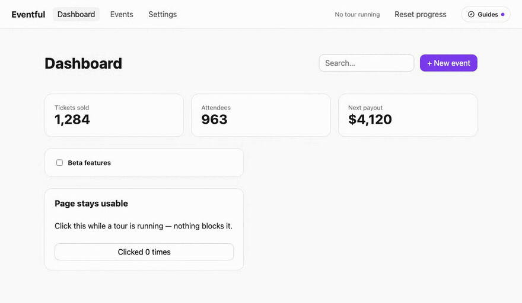

# @guidecursor/react

React 18 and 19 bindings for [Guide Cursor](https://github.com/Eve-Eng01/guidecursor): non-blocking, in-app product tours with an animated guide cursor. Includes `<GuideCursorProvider>`, the `useGuideCursor()` hook and an on-demand `<GuideMenu />`. Everything from `@guidecursor/core` is re-exported.



```bash
npm install @guidecursor/react
```

```tsx
import { GuideCursorProvider, GuideMenu, useGuideCursor, type GuideTour } from "@guidecursor/react";

const tours: GuideTour[] = [
  {
    id: "dashboard",
    title: "Find your way around",
    steps: [
      { target: "[data-tour=search]", title: "Find anything", content: "Search events, people and payouts." },
      { target: "[data-tour=new-event]", title: "Create an event", content: "Start here when you're ready." },
    ],
  },
];

export function App() {
  return (
    <GuideCursorProvider tours={tours} cursor={{ label: "Guide" }}>
      <GuideMenu /> {/* a "Guides" dropdown; nothing starts on its own */}
      <Dashboard />
    </GuideCursorProvider>
  );
}

function HelpButton() {
  const { start } = useGuideCursor();
  return <button onClick={() => start("dashboard")}>Show me around</button>;
}
```

## Learn more

- [Getting started](https://github.com/Eve-Eng01/guidecursor/blob/main/docs/getting-started.md)
- [Multi-page tours with React Router, TanStack Router or Next.js](https://github.com/Eve-Eng01/guidecursor/blob/main/docs/guides/multi-page-tours.md)
- [Contextual "How does this work?" buttons](https://github.com/Eve-Eng01/guidecursor/blob/main/docs/guides/contextual-help.md)
- [React API reference](https://github.com/Eve-Eng01/guidecursor#react)
- [Examples](https://github.com/Eve-Eng01/guidecursor/tree/main/examples)

MIT licensed. Issues and contributions welcome on [GitHub](https://github.com/Eve-Eng01/guidecursor).
